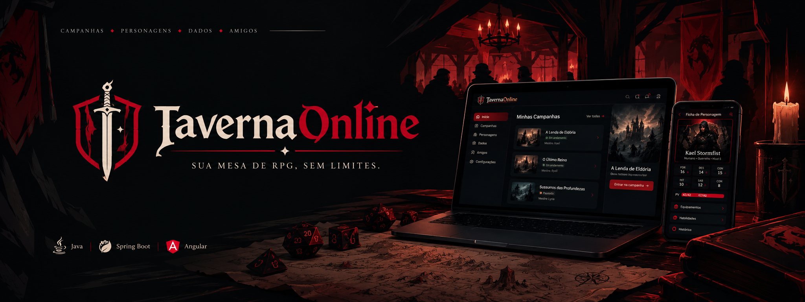
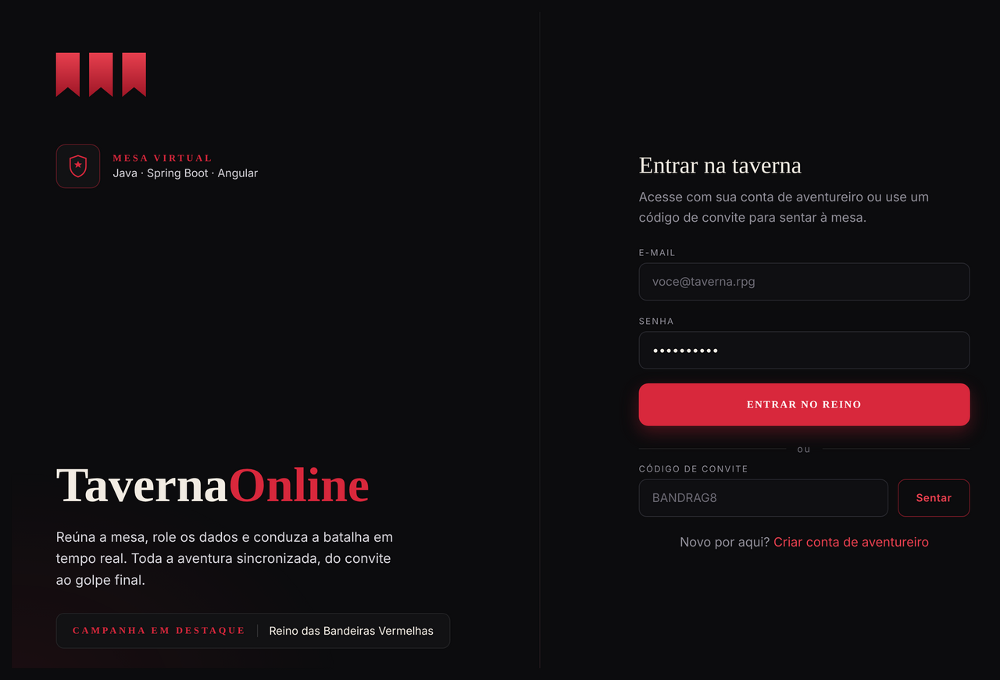
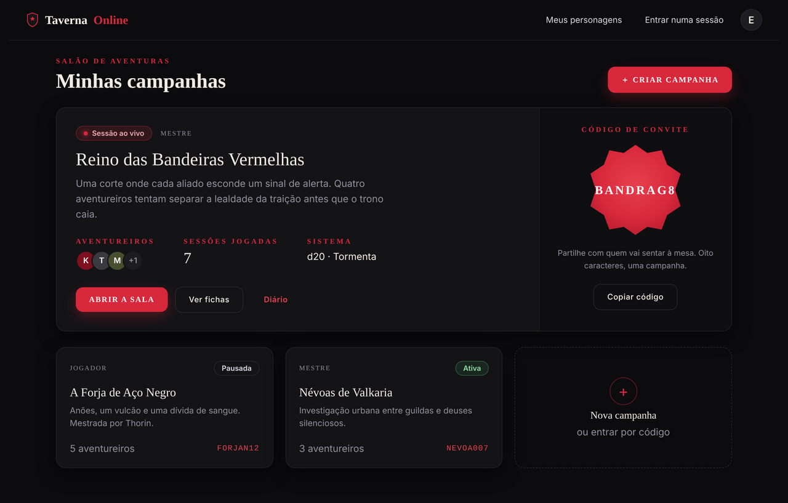
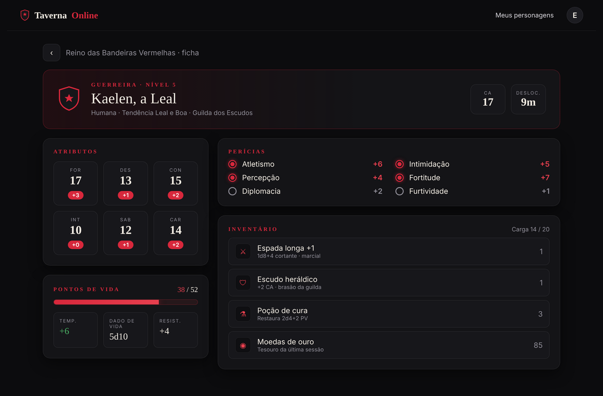
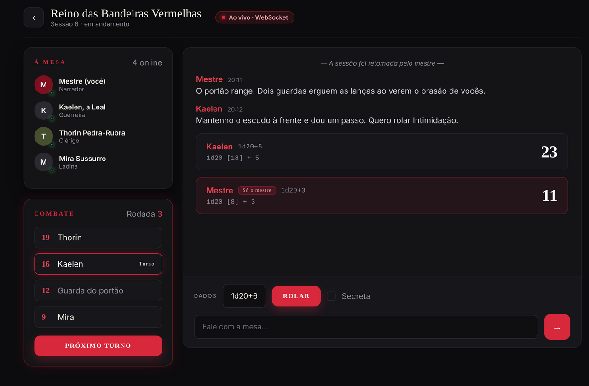
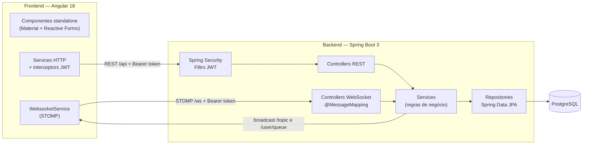
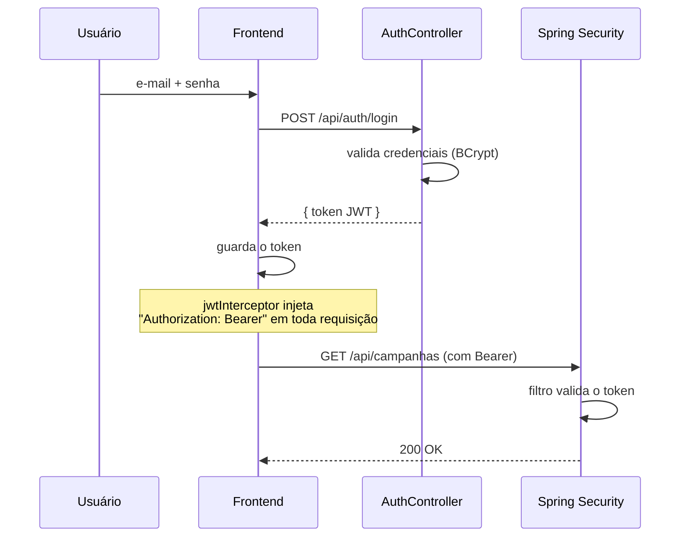
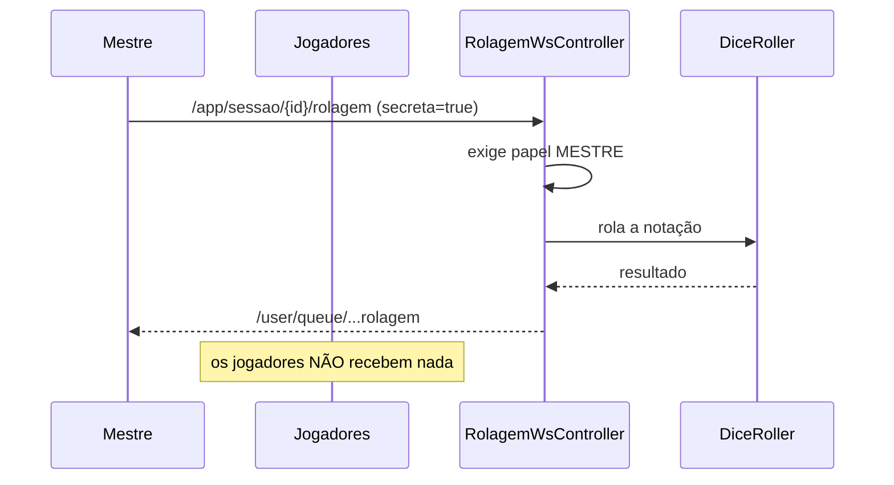

<div align="center">



### Mesa virtual para sessões de RPG de mesa, em tempo real

[](https://openjdk.org/)
[](https://spring.io/projects/spring-boot)
[](https://angular.dev/)
[](https://www.postgresql.org/)
[](LICENSE)

Mestre cria a campanha, convida os jogadores por um código, e todos jogam juntos numa sala com **chat, rolagem de dados, tracker de iniciativa e diário** — tudo sincronizado em tempo real via WebSocket.

</div>

---

## 📖 Sobre

O **TavernaOnline** é uma aplicação full-stack que simula uma mesa de RPG online. O foco do projeto é demonstrar, de ponta a ponta, decisões de arquitetura reais: autenticação com JWT, comunicação em tempo real com STOMP sobre WebSocket, um motor de dados testável e uma separação limpa entre camadas.

> Projeto de portfólio construído em etapas pequenas e bem documentadas, pensado para ser explicado em entrevista.

---

## 🖼️ Demonstração

> Interface **"Reino das Bandeiras Vermelhas"**: quase-preto com carmesim de dragão, títulos em Cinzel e UI em Inter. Login em split-screen, salão de campanhas com selo de convite, ficha de personagem com barra de vida e perícias, e a sala ao vivo com tracker de iniciativa e cartões de rolagem (as secretas visíveis só para o mestre).

<div align="center">

### Login


### Campanhas — criar, entrar por convite e abrir sessões


### Ficha de personagem editável


### Sala de sessão em tempo real


</div>

---

## ✨ Funcionalidades

- [x] Cadastro e login com **JWT**
- [x] Campanhas com **convite por código**
- [x] **Fichas de personagem** editáveis (atributos, perícias, inventário, pontos de vida)
- [x] **Sala de sessão em tempo real** (WebSocket / STOMP)
- [x] Rolagem de dados com notação (`2d6+3`, `1d20+1d4+2`) e **rolagens secretas do mestre**
- [x] **Tracker de iniciativa** e controle de turnos
- [x] **Diário da campanha** com anotações públicas ou só-do-mestre
- [x] Indicação de **jogadores online** na sala

---

## 🛠️ Stack

| Camada | Tecnologias |
|---|---|
| **Backend** | Java 21, Spring Boot 3, Spring Data JPA, Spring Security + JWT, Bean Validation, MapStruct, Flyway |
| **Banco** | PostgreSQL 16 |
| **Tempo real** | WebSocket + STOMP |
| **Frontend** | Angular 18 (standalone components), Angular Material (tema real customizado), Reactive Forms, `@stomp/stompjs` |
| **Testes** | JUnit 5, Mockito, Jasmine/Karma |
| **Infra** | GitHub Actions (CI com PostgreSQL de serviço) |

---

## 🏗️ Arquitetura



As camadas do backend seguem o fluxo **Controller → Service → Repository**, com DTOs nas bordas (mapeados por MapStruct) e tratamento global de erros via `@RestControllerAdvice`. O domínio é organizado **por funcionalidade** (`auth`, `campanha`, `personagem`, `sessao`, `chat`, `rolagem`, `diario`), e não por tipo técnico.

---

## 🔄 Fluxos principais

### 1. Autenticação com JWT



### 2. Rolagem secreta do mestre (WebSocket)



> Numa rolagem pública o servidor transmite para `/topic/sessao.{id}.rolagem` (todos recebem). Na secreta, usa `/user/queue` — roteamento direcionado do STOMP pelo `Principal` setado no handshake.

### 3. Turno de combate

```mermaid
sequenceDiagram
    participant M as Mestre
    participant C as CombateService
    participant T as /topic/...combate

    M->>C: POST /combate/iniciar (lista de iniciativa)
    C->>C: ordena por iniciativa (desc)
    C->>T: estado do combate
    M->>C: POST /combate/proximo-turno
    C->>C: avança índice; ao dar a volta, +1 rodada
    C->>T: novo estado (quem é a vez)
```

---

## 🚀 Como rodar

### Pré-requisitos
- Java 21
- Node 20+
- PostgreSQL 16

### 1. Banco de dados
No `psql` ou pgAdmin, como superusuário:

```sql
CREATE USER taverna WITH PASSWORD 'taverna';
CREATE DATABASE tavernaonline OWNER taverna;
CREATE DATABASE tavernaonline_test OWNER taverna;
```

As tabelas são criadas automaticamente pelo **Flyway** quando o backend sobe.

### 2. Backend

```bash
cd backend
mvn spring-boot:run
```

- API em `http://localhost:8080`
- Documentação Swagger em `http://localhost:8080/swagger-ui.html`

### 3. Frontend

```bash
cd frontend
npm install
npm start
```

- Aplicação em `http://localhost:4200`

---

## 🗂️ Estrutura do projeto

```
tavernaonline/
├── backend/                 # Spring Boot 3 (Java 21)
│   └── src/main/java/br/com/tavernaonline/
│       ├── config/          # Security, WebSocket, OpenAPI, CORS
│       ├── security/        # JwtService, filtros, auth do WebSocket
│       ├── common/          # EntidadeBase, exceções, handler global
│       ├── auth/ campanha/ personagem/ sessao/ chat/ rolagem/ diario/
│       └── rolagem/motor/   # DiceParser + DiceRoller (com testes)
├── frontend/                # Angular 18 (standalone)
│   └── src/app/
│       ├── core/            # auth, interceptors, services, websocket
│       └── features/        # auth, campanhas, personagens, sessao, diario
├── docs/                    # diagramas, prints, roadmap
└── .github/workflows/       # CI (build + testes)
```

---

## 🧪 Testes

```bash
# Backend
cd backend && mvn verify

# Frontend
cd frontend && npm run test:ci
```

O destaque dos testes é o **motor de dados**: o `DiceRoller` recebe um `RandomGenerator` injetado, então nos testes um gerador fixo torna o resultado **determinístico** — dá para afirmar que `2d6+3` com os dados `[4,2]` resulta em `9`. Há também cobertura das notações inválidas, das regras de convite/permissão e das transições de turno do combate.

---

## 🧠 Decisões técnicas

Algumas escolhas e o porquê (as demais estão em [`docs/DECISOES.md`](docs/DECISOES.md)):

- **Presença online fora do banco** — quem está na sala é um dado efêmero, então vive em memória (`ConcurrentHashMap`) alimentado pelos eventos de conexão/desconexão do STOMP.
- **IDs em UUID** — evitam enumeração de recursos pela URL.
- **`ddl-auto: validate` + Flyway** — o schema é versionado por migrations; o Hibernate apenas confere, nunca gera as tabelas.
- **Optimistic lock (`@Version`) nas fichas** — duas edições simultâneas resultam em `409 Conflict` em vez de sobrescrita silenciosa.
- **`RandomGenerator` injetado** — torna o motor de dados testável e determinístico.

---

## 📄 Licença

Distribuído sob a licença MIT. Veja [LICENSE](LICENSE).
